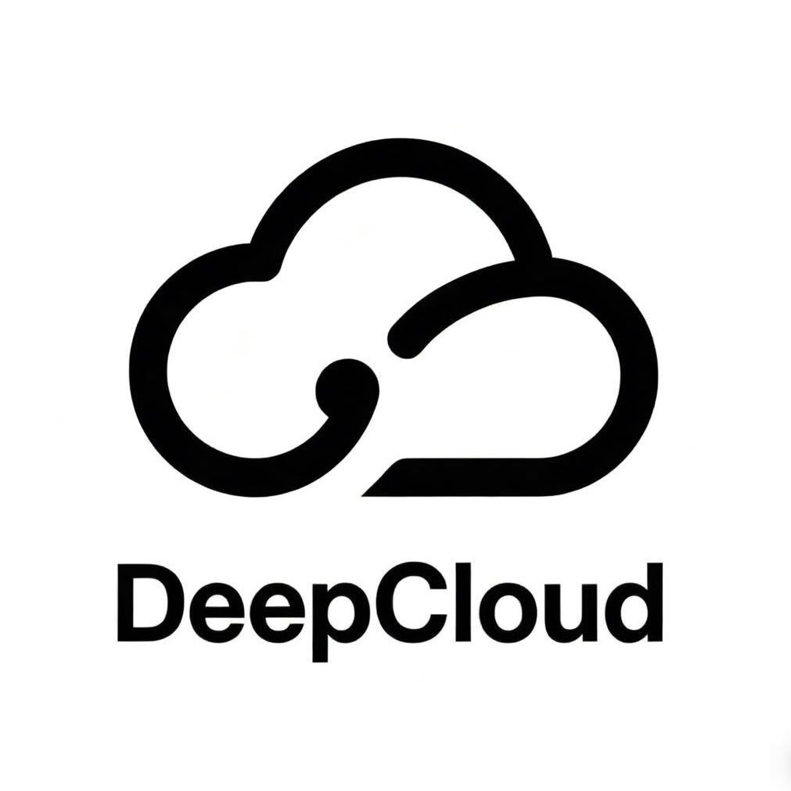

<div align="center">



# Agent Link

### 深度云创科技（DeepCloud）的统一 AI Agent 网关

Agent Link 把多个 AI coding agent、模型提供商、订阅账号和本地模型集中到一个桌面应用与本地网关中。

[](https://github.com/crazymsn/Agent-Link) [](LICENSE)

**[项目主页](https://github.com/crazymsn/Agent-Link)** &nbsp;·&nbsp; **[参考文档](docs/reference.md)** &nbsp;·&nbsp; [English](README.md)

</div>

## 核心能力

- **一个模型列表连接多个 Agent**：统一管理 Claude Code、Codex、Gemini CLI、OpenCode 等工具的模型配置。
- **本地统一网关**：兼容 OpenAI Chat、OpenAI Responses、Anthropic Messages 和 Gemini 请求协议。
- **订阅与 API Key 并行使用**：支持订阅账号、第三方 API、局域网模型和本地模型。
- **路由与故障转移**：按顺序、轮换、用量和额度策略在模型、账号和 provider 之间切换。
- **插件系统**：插件负责登录、模型列表、请求转发和扩展页面，Agent Link 负责统一编排。

## API 分发站

Agent Link 内置固定的 **API 分发站** 订阅提供商，Base URL 为：

```text
https://api.meding.site/v1
```

使用步骤：

1. 打开 [https://api.meding.site](https://api.meding.site) 创建 API 令牌。
2. 打开 Agent Link 的 **提供商** 页面。
3. 在排在 Claude 前面的 **API 分发站** provider 中填入 API 令牌。
4. 保存后即可通过该 provider 获取 API 分发站提供的全部模型。

该 provider 的名称、Base URL 和 DeepCloud 图标由 Agent Link 固定维护；用户只需要填写令牌并选择模型。默认网关端口是 `7500`，已有配置中的自定义端口会继续生效。

## 快速开始

启动 Agent Link 后，先在 **提供商** 页面配置 API 分发站或其他内置 provider，再到 **Agents** 页面为每个 Agent 选择模型。

命令行示例：

```sh
agent-link providers
agent-link claude api-distribution/<model-id>
agent-link codex api-distribution/<model-id>
agent-link tui
```

其他兼容 OpenAI 的工具可以使用本地网关：

```sh
export OPENAI_BASE_URL=http://127.0.0.1:7500/v1
export OPENAI_API_KEY=agent-link
```

## 插件

插件运行在独立的插件宿主中，可以提供登录、模型发现、请求转发、额度和 GUI 页面。新插件模板和用户可见名称统一使用 Agent Link / DeepCloud 品牌；历史 provider ID、配置文件名和兼容环境变量继续保留，以免已安装插件和既有 Agent 配置失效。

## 隐私与安全

API 令牌只写入本机受保护的 provider 配置，并用于你选择的上游服务。不要把令牌提交到 Git 仓库、截图、日志或 Issue。Agent Link 保留上游项目要求的 MIT 许可证和相关版权声明。

## 联系我们


如需产品支持、部署协助或商务合作，请扫描二维码联系深度云创科技（DeepCloud）。

## 许可证

[MIT](LICENSE)

Agent Link / DeepCloud 基于本仓库保留许可证的上游项目构建。
